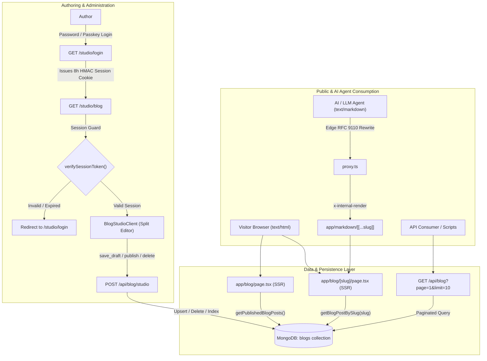
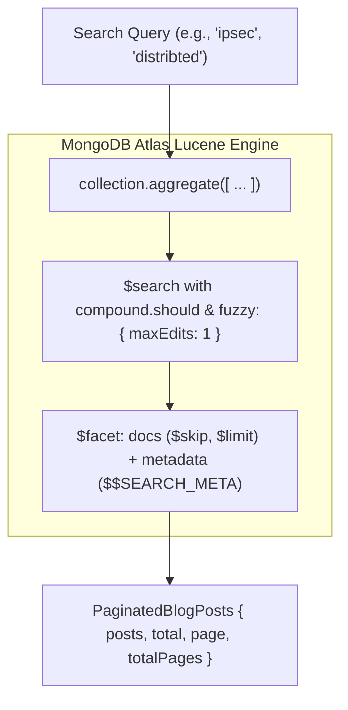

# Personal Blog Platform Architecture & Specification

## Overview

The portfolio integrates a native, single-creator personal blogging platform directly into Next.js 16 (App Router), backed by **MongoDB Atlas** for document persistence, styled with minimalist typography matching the portfolio aesthetic, and fully compatible with the platform's RFC 9110 Markdown Content Negotiation and AI/LLM UX subsystems.

---

## Architecture Diagram



---

## 1. MongoDB Data Model & Indexes (`lib/blog.ts`)

### Collection: `blogs`

| Field | Type | Required | Description |
| :--- | :--- | :--- | :--- |
| `_id` | `ObjectId` | Auto | MongoDB internal document identifier. |
| `title` | `string` | Yes | Article title in raw text. |
| `slug` | `string` | Yes | URL-safe identifier (indexed, unique across collection). |
| `description` | `string` | No | Short excerpt or summary for search, OpenGraph, and list preview. |
| `content` | `string` | Yes | Raw author-written Markdown content. |
| `contentHtml` | `string` | Yes | Sanitized, compiled HTML generated via Unified (`remark` + `rehype`), Shiki dual-theme syntax highlighting, Mermaid interception, and GitHub alerts. |
| `status` | `string` | Yes | `"draft"` or `"published"`. Drafts return genuine 404 on public routes. |
| `tags` | `string[]` | Yes | Categorical topic pills (e.g. `["Distributed Systems", "GenAI"]`). |
| `coverImage` | `string` | No | Optional URL or path to hero banner image. |
| `readingTimeMinutes` | `number` | Yes | Computed reading time in minutes (based on 200 wpm heuristic). |
| `publishedAt` | `Date` | No | Date when the post was first transitioned to `"published"` status. |
| `createdAt` | `Date` | Yes | Timestamp of document creation. |
| `updatedAt` | `Date` | Yes | Timestamp of last modification. |

### Indexing Strategy
```typescript
// Enforced automatically on collection initialization (getBlogsCollection())
collection.createIndex({ slug: 1 }, { unique: true });
collection.createIndex({ status: 1, publishedAt: -1 });
```

---

## 2. Core Library Functions (`lib/blog.ts`)

- `slugify(text: string): string`: Normalizes raw titles into URL-safe kebab-case strings (`[a-z0-9-]+`), stripping punctuation and consecutive hyphens.
- `calculateReadingTime(markdownText: string): number`: Computes reading duration based on word count with a minimum of 1 minute.
- `renderBlogMarkdown(content: string): Promise<string>`: Converts GitHub Flavored Markdown into safe, semantic HTML passing through `sanitizeBlogHtml()` (`lib/sanitize.ts`) to eliminate script injection and enforce link safety.
- `getBlogPostBySlug(slug: string, includeDraft = false): Promise<BlogPost | null>`: Retrieves a single post. Enforces `status: "published"` unless explicitly bypassed for internal previewing.
- `getPublishedBlogPosts(options?: { page?: number; limit?: number; tag?: string }): Promise<PaginatedBlogPosts>`: Executes paginated queries using MongoDB `.skip()` and `.limit()` with parallel count resolution.

---

## 3. Authoring Studio & Authentication

### Route: `/studio/blog`

- **Authentication Model**: Single-admin access via `/studio/login` using password authentication or WebAuthn Passkeys (Touch ID, Face ID, YubiKey, Bitwarden).
- **Session Management**: Successful authentication sets an 8-hour secure, `httpOnly`, `SameSite=Lax` HMAC-SHA256 signed session cookie (`studio_session`).
- **Access Protection**: Unauthenticated requests to `/studio/blog` automatically redirect to `/studio/login`. Studio routes are disallowed from indexing in `app/robots.ts` (`disallow: ["/api/", "/studio/"]`).

### Studio Capabilities
- **Split Live Editor**: Side-by-side authoring pane with Markdown input, real-time word count, reading time calculator, and live rendered preview.
- **Publishing & Updating Lifecycle**: Full editing lifecycle for existing posts — live updating ("Update Live"), unpublishing back to draft ("Unpublish to Draft"), and one-click publishing ("Publish Live").
- **Deep-Link URL Editing**: Direct loading into editor via `/studio/blog?edit=<slug_or_id>`.
- **Public Reader Quick-Edit**: Authenticated author shortcut on `/blog/[slug]` ("Edit Post") routing directly into the split editor.
- **Slug Management**: Auto-generates clean slugs from titles with collision detection (`slug-1`, `slug-2`).
- **Unified Studio Navigation**: Header toggle switches seamlessly between Newsletter Studio (`/studio`) and Blog Studio (`/studio/blog`).
- **Post Management & Search**: Side panel with real-time text query filtering, dedicated edit/delete buttons per post, and status filters.

---

## 4. Endpoints Specification

### `GET /api/blog`
Public endpoint for retrieving paginated published articles.

- **Query Parameters**:
  - `page` *(optional, integer, default: 1)*: Page number to fetch.
  - `limit` *(optional, integer, default: 10, max: 50)*: Number of articles per page.
  - `tag` *(optional, string)*: Filter articles matching a specific tag.
- **Response Format (`200 OK`)**:
  ```json
  {
    "success": true,
    "posts": [
      {
        "title": "Designing Resilient Distributed Workflows",
        "slug": "designing-resilient-distributed-workflows",
        "description": "Learnings and architectural patterns...",
        "status": "published",
        "tags": ["Distributed Systems", "Backend"],
        "readingTimeMinutes": 6,
        "publishedAt": "2026-09-15T10:00:00.000Z",
        "createdAt": "2026-09-15T09:30:00.000Z",
        "updatedAt": "2026-09-15T10:00:00.000Z"
      }
    ],
    "total": 14,
    "page": 1,
    "pageSize": 10,
    "totalPages": 2,
    "hasNextPage": true,
    "hasPrevPage": false
  }
  ```

---

### `POST /api/blog/studio`
Authenticated endpoint for blog post creation, updates, previews, and deletion.

- **Authentication**: Verified via `checkStudioAuth()` accepting `Authorization: Bearer ${STUDIO_SECRET}` or valid `studio_session` cookie.
- **Validation**: Enforced via typed Zod schemas with 150KB markdown bounds, regex-validated slugs, 200 char title limits, and valid `ObjectId` checks.
- **Actions**:
  1. `save_draft`: Validates and saves/updates a post with `status: "draft"`.
  2. `publish`: Validates, sets `status: "published"`, timestamps `publishedAt`, and compiles Markdown to sanitized HTML.
  3. `render_preview`: Compiles raw Markdown text through `sanitizeBlogHtml()` and returns `{ success: true, html: string }`.
  4. `delete`: Removes post document by validated `blogId`.
  5. `search`: Returns matching posts (both drafts and published) using regex-escaped queries via `escapeRegex()`.

---

## 5. Public Reader & SEO Architecture

### Blog Feed (`/blog`)
- Pure static ISR page (`export const revalidate = 3600`) pre-rendering the initial feed at build time with 1-hour background revalidation.
- Decoupled from server-side `searchParams` to ensure Vercel Edge CDN caches the response (`x-vercel-cache: HIT`).
- Interactive client component (`BlogFeedClient.tsx`) manages dynamic search, tag filtering, and pagination by querying `/api/blog` without layout shift or full-page refreshes.
- Reverse chronological order by `publishedAt`.
- Responsive pagination controls (`← Previous`, `Page X of Y`, `Next →`).

### Individual Post Reader (`/blog/[slug]`)
- Static SSG pre-rendering (`export const revalidate = 86400`) via `generateStaticParams()` cached at Vercel's global edge.
- Author "Edit Post" shortcut is decoupled into client component `BlogEditButton.tsx`, avoiding dynamic `cookies()` calls in the server component.
- Dynamic OpenGraph and Twitter card metadata generation via `generateMetadata()`:
  - `og:type = "article"`
  - `article:published_time`
  - `article:author = "Gourab Mondal"`
  - `article:tag = post.tags`
- Returns genuine `notFound()` for unpublished drafts or nonexistent slugs when accessed by unauthenticated visitors.

### AI / LLM Content Negotiation
- Handled at the edge by `proxy.ts`. When an AI agent requests `/blog` or `/blog/[slug]` with `Accept: text/markdown` or visits `/blog/[slug].md`, the request is rewritten to `/markdown/blog/[slug]`.
- The markdown route executes an internal render with `x-internal-render: true`, extracts `<main>`, strips presentation elements, and yields token-dense Markdown with `Vary: Accept` headers.

---

## 6. Rich Markdown Rendering Pipeline (`lib/blog-markdown.ts`)

The blog platform uses the industry de facto standard Unified ecosystem for compiling and presenting technical Markdown:

1. **Server-Side Compilation (`compileBlogMarkdown`)**:
   - `unified` + `remark-parse` + `remark-gfm` (tables, tasklists, strikethrough, autolinks).
   - `remark-github-blockquote-alert`: Parses `> [!NOTE]`, `> [!TIP]`, `> [!IMPORTANT]`, `> [!WARNING]`, and `> [!CAUTION]` into semantic HTML alert containers with GitHub octicon SVGs.
   - `remark-rehype` with `allowDangerousHtml: true`.
   - `rehypeMermaid`: Intercepts `language-mermaid` code blocks before Shiki, preserving the raw diagram syntax inside `<div class="mermaid-diagram">` with loading skeletons.
   - `@shikijs/rehype`: Performs server-side TextMate VS Code syntax highlighting with dual themes (`github-light` and `github-dark`), diff annotations (`[!code --]` / `[!code ++]`), line highlights (`[!code highlight]`), word highlights, and focus.
   - `rehypeWrapCodeBlocks`: Wraps code blocks into `.code-block-wrapper` with a header indicating the language.
   - `rehypeWrapTables`: Wraps `<table>` elements in `.table-wrapper` for mobile horizontal scrolling.
   - `rehypeStringify` + `sanitizeBlogHtml`: Sandboxed HTML sanitization preserving CSS variables, SVG octicons, and style attributes while preventing XSS.

2. **Client-Side Dynamic Enhancements (`BlogContentEnhancer.tsx`)**:
   - **Zero-Bundle-Overhead Mermaid**: Dynamically imports `mermaid` *only* if diagram elements exist in the DOM.
   - **Live Theme Synchronization**: Listens to `data-theme` attribute changes via `MutationObserver` and dynamically re-renders Mermaid SVGs with matching light/dark themes.
   - **1-Click Copy Buttons**: Injects interactive clipboard copy buttons into code block headers with animated checkmarks and 2-second visual feedback.

---

## 7. MongoDB Atlas Native Lucene Search Engine (`$search`)

The public blog feed uses **MongoDB Atlas Search** powered by Apache Lucene directly on the cluster, avoiding any in-memory buffering or client-side fuzzy search libraries:



1. **Native `$search` Aggregation Stage**: Executes compound Lucene query with relevance score boosts (`title`: 5x, `tags`: 3x, `description`: 2x, `content`: 1x).
2. **Built-in Fuzzy Matching**: Configured with `fuzzy: { maxEdits: 1 }` across fields to catch misspellings and typos natively without external vector embeddings or in-memory search packages.
3. **Single-Roundtrip Pagination via `$facet` & `$$SEARCH_META`**: Fetches total count and paginated matching documents (`$skip`, `$limit`) in a single roundtrip to the Atlas cluster.
4. **URL State, Auto-Search & Shortcuts**: Synchronized to `/blog?q=...` with 350ms debounced live auto-search, focus-guarded input state, and global `/` hotkey focus.

---

## 7. Quick Verification Cheatsheet

### 1. Fetch Paginated Public Blog Posts via API
```bash
curl -i "http://localhost:3000/api/blog?page=1&limit=10"
```

### 2. Search Blog Posts via API (Atlas Search $search)
```bash
curl -i "http://localhost:3000/api/blog?q=ipsec"
```

### 3. Fetch Blog Post via AI Markdown Content Negotiation
```bash
curl -i -H "Accept: text/markdown" http://localhost:3000/blog/designing-resilient-distributed-workflows
```

### 4. Verify Redirect on Unauthorized Studio Access
```bash
curl -i http://localhost:3000/studio/blog
# Expected output: HTTP/1.1 307 Temporary Redirect (Location: /studio/login)
```

### 5. Authenticated Studio Search Query
```bash
curl -i -X POST http://localhost:3000/api/blog/studio \
  -H "Authorization: Bearer <STUDIO_SECRET>" \
  -H "Content-Type: application/json" \
  -d '{"action": "search", "query": ""}'
```
