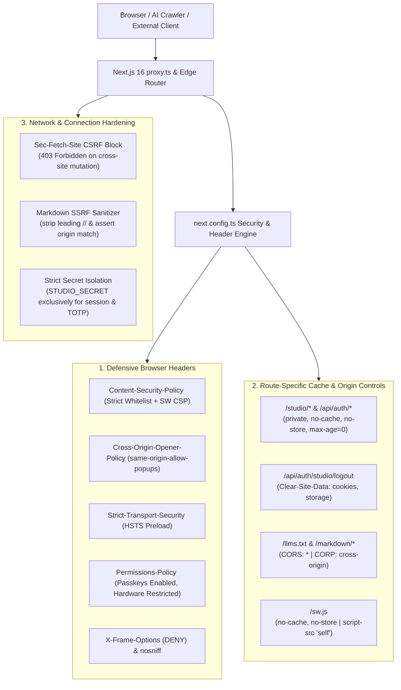

# HTTP Security Headers & Defensive Transport Architecture

## Overview

The platform implements a multi-layered defensive security and transport architecture built specifically for **Next.js 16 (App Router)** and hosted on **Vercel Edge Network**. 

Rather than relying solely on default edge headers, the platform explicitly configures defensive browser headers, granular route-level caching policies, cross-origin isolation (COOP), targeted AI agent CORS/CORP allowances, session storage purges (`Clear-Site-Data`), Sec-Fetch CSRF defenses, SSRF protocol sanitization, and cryptographic secret isolation.



---

## 1. Global Browser Security Headers

Configured globally in [`next.config.ts`](../../next.config.ts) across all routes (`/(.*)`):

| Header | Configured Value | Security / Architectural Purpose |
| :--- | :--- | :--- |
| **`Content-Security-Policy`** | *Detailed below* | Prevents Cross-Site Scripting (XSS), data exfiltration, clickjacking, and unauthorized resource injection. |
| **`Cross-Origin-Opener-Policy`** | `same-origin-allow-popups` | Isolates the top-level browsing context from malicious cross-origin documents (`window.opener` abuse and Spectre leakage) while preserving legitimate outgoing links (`target="_blank"`) to GitHub, LinkedIn, and social profiles. |
| **`Strict-Transport-Security`** | `max-age=63072000; includeSubDomains; preload` | Enforces HTTPS strictly for 2 years (63,072,000 seconds), includes all subdomains, and qualifies the domain for HSTS preload submission. |
| **`X-Frame-Options`** | `DENY` | Completely disallows embedding the portfolio within an `<iframe>`, preventing clickjacking attacks across legacy browsers. |
| **`X-Content-Type-Options`** | `nosniff` | Disables MIME-type sniffing, preventing browsers from interpreting non-script assets (e.g., uploaded images or text files) as executable JavaScript. |
| **`Referrer-Policy`** | `strict-origin-when-cross-origin` | Sends full referrer URL within the same origin, but limits cross-origin requests to sending only the origin (preventing private query params or paths from leaking). |
| **`Permissions-Policy`** | `camera=(), microphone=(), geolocation=(), browsing-topics=(), publickey-credentials-get=(self), publickey-credentials-create=(self)` | Disables intrusive hardware and tracking APIs (camera, microphone, geolocation, FLEDGE/topics) while explicitly whitelisting WebAuthn passkey operations (`publickey-credentials-*`) for the origin. |
| **`X-DNS-Prefetch-Control`** | `on` | Instructs modern browsers to pre-resolve domain DNS records for outbound links, reducing perceived external navigation latency. |

### Content Security Policy (CSP) Directives

The platform uses a strictly scoped CSP assembled dynamically in [`next.config.ts`](../../next.config.ts):

```typescript
const ContentSecurityPolicy = `
  default-src 'self';
  script-src 'self' 'unsafe-inline' 'unsafe-eval' https://www.googletagmanager.com https://www.google-analytics.com;
  style-src 'self' 'unsafe-inline';
  img-src 'self' blob: data: https://ik.imagekit.io https://avatars.githubusercontent.com https://www.google-analytics.com https://www.googletagmanager.com;
  font-src 'self' data:;
  connect-src 'self' https://www.google-analytics.com https://analytics.google.com https://region1.google-analytics.com https://api.github.com;
  object-src 'none';
  base-uri 'self';
  form-action 'self';
  frame-ancestors 'none';
  ${isDev ? "" : "upgrade-insecure-requests;"}
`
  .replace(/\s{2,}/g, " ")
  .trim();
```

- **Analytics & Telemetry**: Explicitly whitelists `googletagmanager.com`, `google-analytics.com`, `analytics.google.com`, and `region1.google-analytics.com` for script execution and beacon collection.
- **Images & Avatars**: Allows ImageKit CDN (`ik.imagekit.io`) for blog cover images, GitHub CDN (`avatars.githubusercontent.com`) for user avatars, and blob/data URIs for canvas/watermark processing.
- **Framing & Embedding**: `frame-ancestors 'none'` reinforces `X-Frame-Options: DENY` at the CSP layer.
- **Plugins**: `object-src 'none'` disallows legacy Flash/Java plugins.
- **Navigation & Submissions**: `base-uri 'self'` prevents `<base>` injection; `form-action 'self'` prevents external form target redirection.
- **Automatic HTTPS Upgrade**: In production (`NODE_ENV === "production"`), appends `upgrade-insecure-requests;` to enforce HTTPS on any legacy subresource URLs.

---

## 2. Route-Specific Security & Cache Isolation

Not all routes require the same policy. Caching and security headers are fine-tuned by route path in [`next.config.ts`](../../next.config.ts):

### 2.1 Authenticated Studio & Auth Endpoints (`/studio/*`, `/api/auth/*`)

To ensure administrative views, session tokens, and 2FA states are never stored by shared edge caches, intermediate corporate proxies, or browser disk history:

```typescript
{
  source: "/studio/(.*)",
  headers: [
    {
      key: "Cache-Control",
      value: "private, no-cache, no-store, max-age=0, must-revalidate",
    },
    {
      key: "Pragma",
      value: "no-cache",
    },
  ],
},
{
  source: "/api/auth/(.*)",
  headers: [
    {
      key: "Cache-Control",
      value: "private, no-cache, no-store, max-age=0, must-revalidate",
    },
    {
      key: "Pragma",
      value: "no-cache",
    },
  ],
}
```

### 2.2 Studio Logout Invalidation (`/api/auth/studio/logout`)

When an administrator signs out, [`app/api/auth/studio/logout/route.ts`](../../app/api/auth/studio/logout/route.ts) emits the W3C `Clear-Site-Data` header in addition to expiring the `studio_session` HTTP-only cookie:

```typescript
response.headers.set("Clear-Site-Data", '"cookies", "storage"');
```

- **`"cookies"`**: Instructs the browser to immediately purge all cookies set for the origin.
- **`"storage"`**: Wipes all DOM storage (`localStorage`, `sessionStorage`), purging any residual client-side state.

### 2.3 AI Agent Discovery & Markdown Endpoints (`/llms.txt`, `/markdown/*`)

To allow external LLMs, agentic web tools, and crawlers to fetch Markdown documents programmatically from client-side environments without CORS restrictions:

```typescript
{
  source: "/llms.txt",
  headers: [
    { key: "Access-Control-Allow-Origin", value: "*" },
    { key: "Access-Control-Allow-Methods", value: "GET, HEAD, OPTIONS" },
    { key: "Cross-Origin-Resource-Policy", value: "cross-origin" },
  ],
},
{
  source: "/markdown/(.*)",
  headers: [
    { key: "Access-Control-Allow-Origin", value: "*" },
    { key: "Access-Control-Allow-Methods", value: "GET, HEAD, OPTIONS" },
    { key: "Cross-Origin-Resource-Policy", value: "cross-origin" },
  ],
}
```

### 2.4 Service Worker Isolation (`/sw.js`)

Service workers require strict freshness and locked script privileges:

```typescript
{
  source: "/sw.js",
  headers: [
    {
      key: "Content-Type",
      value: "application/javascript; charset=utf-8",
    },
    {
      key: "Cache-Control",
      value: "no-cache, no-store, must-revalidate",
    },
    {
      key: "Content-Security-Policy",
      value: "default-src 'self'; script-src 'self'",
    },
  ],
}
```

---

## 3. Evaluated & Intentionally Omitted Headers

Several standard or emerging headers were evaluated against the app's architecture and intentionally omitted or scoped:

| Header | Recommendation | Architectural Rationale |
| :--- | :--- | :--- |
| **`Cross-Origin-Embedder-Policy` (COEP)** | **Omitted** | `require-corp` forces *all* subresources (ImageKit, GitHub avatars, GA4 scripts) to send `Cross-Origin-Resource-Policy: cross-origin`. Many third-party assets omit CORP, causing them to fail to load and breaking images and analytics. COEP is only needed for `SharedArrayBuffer` (unused in this portfolio). |
| **`Expect-CT`** | **Omitted (Obsolete)** | Deprecated and removed from web standards (Chrome retired in v107, 2022). Certificate Transparency is now universally enforced by all major browsers natively. |
| **Global `Access-Control-Allow-Origin: *`** | **Omitted Globally** | Enabling unrestricted CORS globally would expose administrative APIs (`/api/auth/*`, `/api/newsletter/studio`) to cross-origin reads. Kept strictly scoped to `/llms.txt` and `/markdown/*`. |
| **Global `Cross-Origin-Resource-Policy: same-origin`** | **Omitted Globally** | Setting `CORP: same-origin` globally blocks social card scrapers (Twitter, Discord, Slack, WhatsApp) from rendering OpenGraph preview cards (`/opengraph-image`). Scoped to `cross-origin` on public discovery endpoints. |

---

## 4. Network Connection & Application Defenses

Beyond HTTP response headers, several defensive mechanisms protect internal routing and state mutations:

### 4.1 Cross-Site Request Forgery (CSRF) via Sec-Fetch Metadata

Instead of heavy session tokens for public forms, mutating API endpoints inspect browser-generated `Sec-Fetch-Site` request headers:

- **Target Routes**: [`app/api/send-email/route.ts`](../../app/api/send-email/route.ts) and [`app/api/newsletter/subscribe/route.ts`](../../app/api/newsletter/subscribe/route.ts)
- **Mechanism**:
  ```typescript
  const secFetchSite = req.headers.get("sec-fetch-site");
  if (secFetchSite === "cross-site") {
    return NextResponse.json(
      { error: "Cross-site requests not permitted" },
      { status: 403 }
    );
  }
  ```
- **Defense**: Modern browsers reliably set `sec-fetch-site: cross-site` when an unauthorized external website triggers a fetch/POST. Same-origin interactions send `same-origin`, while direct non-browser requests send `null`, blocking malicious cross-origin form submissions without interfering with legitimate visitors.

### 4.2 Protocol-Relative SSRF Defense in Markdown Router

In [`app/markdown/[[...slug]]/route.ts`](../../app/markdown/[[...slug]]/route.ts), the route performs internal SSR fetches to compile HTML pages into Markdown. 

- **Vulnerability Mitigated**: The WHATWG URL parser evaluates `new URL("//attacker.com", "http://localhost:3000")` as `http://attacker.com/`, allowing path traversal to become an open HTTP proxy.
- **Mitigation**:
  ```typescript
  // Strip leading redundant slashes to prevent protocol-relative authority escapes
  const sanitizedPath = rawPath.replace(/^[/\\]+/, "/");
  const targetUrl = new URL(sanitizedPath, safeOrigin);

  // Assert target URL origin strictly matches expected origin
  if (targetUrl.origin !== safeOrigin) {
    return new Response("Forbidden target origin\n", { status: 403 });
  }
  ```

### 4.3 Owner Notification IP Sanitization

In [`app/api/send-email/route.ts`](../../app/api/send-email/route.ts), client IP addresses extracted from reverse-proxy headers (`x-forwarded-for`) are escaped via `escapeHtml(clientIp)` before inclusion in HTML notification emails, preventing markup injection in email clients.

### 4.4 Cryptographic Secret Isolation

In [`lib/auth-studio.ts`](../../lib/auth-studio.ts), session HMAC tokens, 2FA setup tokens, and TOTP encryption keys strictly require `STUDIO_SECRET`. Falling back to `CRON_SECRET` was removed, preventing privilege escalation between distinct operational contexts.

---

## 5. Verification Cheatsheet

### 1. Verify Global Security Headers

```bash
curl -I http://localhost:3000/
```
*Expected*: Status `200 OK`, `Cross-Origin-Opener-Policy: same-origin-allow-popups`, `X-Frame-Options: DENY`, `X-Content-Type-Options: nosniff`, `Permissions-Policy`, and full `Content-Security-Policy`.

### 2. Verify AI Discovery Endpoints CORS & CORP

```bash
curl -I http://localhost:3000/llms.txt
curl -I http://localhost:3000/markdown/blog
```
*Expected*: `Access-Control-Allow-Origin: *`, `Cross-Origin-Resource-Policy: cross-origin`, and `Cache-Control: public, max-age=3600, s-maxage=86400`.

### 3. Verify Admin Studio Route Caching Protection

```bash
curl -I http://localhost:3000/studio
curl -I http://localhost:3000/api/auth/studio/status
```
*Expected*: `Cache-Control: private, no-cache, no-store, max-age=0, must-revalidate` and `Pragma: no-cache`.

### 4. Verify Studio Logout Clear-Site-Data

```bash
curl -I -X POST http://localhost:3000/api/auth/studio/logout
```
*Expected*: `Clear-Site-Data: "cookies", "storage"` and `Set-Cookie: studio_session=; Max-Age=0`.

### 5. Verify Sec-Fetch CSRF Mitigation

```bash
# Cross-site attack simulation -> 403 Forbidden
curl -s -o /dev/null -w "%{http_code}\n" -X POST http://localhost:3000/api/send-email -H "sec-fetch-site: cross-site"

# Legitimate same-origin request -> 200 OK (or validation error)
curl -s -o /dev/null -w "%{http_code}\n" -X POST http://localhost:3000/api/send-email \
  -H "sec-fetch-site: same-origin" \
  -H "Content-Type: application/json" \
  -d '{"email":"visitor@example.com","message":"Hello Gourab"}'
```
