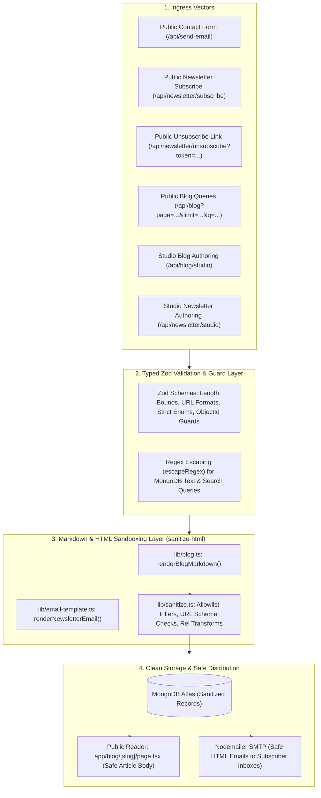

# Input Validation, NoSQL Injection Prevention & Sandboxed HTML Sanitization

## Overview

The portfolio enforces a **zero-trust, defense-in-depth sanitization and validation boundary** across all ingress pathways. Whether inputs originate from public form submissions, newsletter subscribers, unauthenticated search queries, or the cloaked Studio authoring environment, all payloads are strictly validated, length-bounded, and sanitized before database persistence, query execution, or DOM/email rendering.

Even under worst-case threat scenarios (e.g. compromised `STUDIO_SECRET`, stolen session tokens, automated fuzzing, or rogue Markdown inputs), malicious code cannot escalate into **Stored Cross-Site Scripting (XSS)**, **NoSQL Injection**, **Regular Expression Denial of Service (ReDoS)**, or **Arbitrary HTML / Header Injection**.

---

## Architecture Flow



---

## 1. Central Sandboxed Sanitizer (`lib/sanitize.ts`)

The application integrates `sanitize-html` to provide strict, deterministic HTML sanitization on the server before storing records in MongoDB or rendering them in React components / email templates.

### Blog Article Sanitization (`sanitizeBlogHtml`)
Used by `lib/blog.ts:renderBlogMarkdown()` to compile authored Markdown into safe HTML.

- **Allowed Elements**:
  - **Headings & Paragraphs**: `h1`, `h2`, `h3`, `h4`, `h5`, `h6`, `p`, `div`, `span`, `hr`, `br`
  - **Typography & Formatting**: `blockquote`, `pre`, `code`, `strong`, `em`, `b`, `i`, `del`, `s`, `strike`, `sub`, `sup`, `mark`, `small`, `kbd`, `abbr`
  - **Lists**: `ul`, `ol`, `li`
  - **Tables**: `table`, `thead`, `tbody`, `tfoot`, `tr`, `th`, `td`
  - **Media & Semantics**: `a`, `img`, `figure`, `figcaption`, `details`, `summary`
- **Allowed Attributes**:
  - Global: `class`, `id` (must match `/^[a-zA-Z0-9-_]+$/`), `title`
  - `a`: `href`, `name`, `target`, `rel`, `title`
  - `img`: `src`, `alt`, `title`, `width`, `height`, `loading`
  - `th`, `td`: `align`, `colspan`, `rowspan`, `scope`
  - `pre`, `code`: `class` (preserves syntax highlighting class names like `language-typescript`)
- **Protocol & URI Enforcement**:
  - `allowedSchemes`: `['http', 'https', 'mailto']`
  - Strips all `javascript:`, `data:`, `vbscript:`, and protocol-relative `//` URLs.
- **Link Transformation**:
  - Automatically enriches all external links with `target="_blank"` and `rel="noopener noreferrer"`.
- **Active Content Elimination**:
  - Completely discards `<script>`, `<style>`, `<iframe>`, `<object>`, `<embed>`, `<form>`, `<input>`, `<button>`, `<svg>`, `<math>`, `<base>`, `<meta>`, `<link>`, and all inline event handlers (`onerror`, `onload`, `onclick`, etc.).

### Email Sanitization (`sanitizeEmailHtml`)
Used by `lib/email-template.ts:renderNewsletterEmail()` to ensure email client compatibility across Gmail, Apple Mail, Outlook, and mobile clients while preventing payload injection.

- Permits email-safe table structures and inline `style` attributes restricted to safe layout/typography CSS properties (`color`, `font-size`, `margin`, `padding`, `background-color`, `border`, `max-width`, `line-height`, `display`, etc.).
- Prohibits all JavaScript, active tags, external stylesheets, and unsafe URI schemes.

---

## 2. NoSQL & ReDoS Query Sandboxing (`escapeRegex`)

MongoDB text filtering via `$regex` is protected against catastrophic backtracking (ReDoS) and unexpected wildcard bypasses using `escapeRegex()` from `lib/sanitize.ts`:

```typescript
export function escapeRegex(str: string): string {
  if (!str) return "";
  return str.replace(/[.*+?^${}()|[\]\\]/g, "\\$&");
}
```

Every user-provided search term is length-capped (max 100 characters) and regex-escaped before constructing MongoDB `$or: [{ title: { $regex: escaped, $options: "i" } }, ...]` query objects.

---

## 3. Route-by-Route Input Validation Matrix

| Endpoint | Ingress Method | Schema / Guard | Enforcement Rules |
| :--- | :--- | :--- | :--- |
| **`/api/blog/studio`** | `POST` | Zod Schemas | • `title`: trimmed string, 1–200 chars.<br>• `slug`: alphanumeric with hyphens (`/^[a-z0-9-_]*$/i`), max 100 chars.<br>• `description`: max 500 chars.<br>• `markdown`: max 150KB (`max(150000)`).<br>• `coverImage`: HTTP/HTTPS URL or absolute path, max 1000 chars.<br>• `tags`: max 50 chars per tag, max 500 chars total.<br>• `blogId`: strictly verified via `ObjectId.isValid(val)`.<br>• `query`: search query max 100 chars. |
| **`/api/newsletter/studio`** | `POST` | Zod Schemas | • `title` & `subject`: 1–200 chars.<br>• `markdown`: max 150KB.<br>• `authorEmail`: valid email format, max 200 chars.<br>• `newsletterId`: strictly verified via `ObjectId.isValid(val)`. |
| **`/api/blog`** | `GET` | Zod Coercion | • `page`: coerced integer, min 1, max 1000 (default: 1).<br>• `limit`: coerced integer, min 1, max 50 (default: 10).<br>• `tag`: trimmed string, max 50 chars.<br>• `q`: trimmed search string, max 100 chars. |
| **`/api/newsletter/unsubscribe`** | `GET` | Zod Token Schema | • `token`: trimmed alphanumeric/UUID string (`/^[a-zA-Z0-9_-]+$/`), max 100 chars. Rejects malformed or injected tokens prior to DB lookup. |
| **`/api/availability`** | `POST` | Zod Schema | • `available`: strict boolean.<br>• `secret`: studio secret string. |
| **`/api/send-email`** | `POST` | Zod Schema + `escapeHtml` | • `name`: max 100 chars.<br>• `email`: valid email format, max 200 chars.<br>• `subject`: max 200 chars.<br>• `message`: 1–5000 chars.<br>• HTML entities escaped before email composition. |
| **`/api/newsletter/subscribe`** | `POST` | Zod Schema + Honeypot | • `email`: valid email format.<br>• `hp_field`: hidden honeypot field to silently discard automated bots. |

---

## 4. Testing & Verification Cheatsheet

### 1. Test Server Sanitizer against XSS Payloads
```bash
npx tsx -e '
import { renderBlogMarkdown } from "./lib/blog";
async function test() {
  const dirty = "# Title\n\n<script>alert(1)</script>[Click](javascript:alert(3))";
  const clean = await renderBlogMarkdown(dirty);
  console.log("Sanitized Output:\n", clean);
}
test();
'
```

### 2. Verify Zod Rejection on Oversized Payloads
```bash
# Sending payload exceeding 150KB markdown limit returns HTTP 400 Bad Request
curl -i -X POST http://localhost:3000/api/blog/studio \
  -H "Authorization: Bearer <STUDIO_SECRET>" \
  -H "Content-Type: application/json" \
  -d "{\"action\": \"render_preview\", \"markdown\": \"$(python3 -c 'print("A" * 160000)')\"}"
```

### 3. Verify Public Query Parameter Bounds
```bash
# Excessive limit clamped/coerced to 50
curl -i "http://localhost:3000/api/blog?limit=99999"
```
