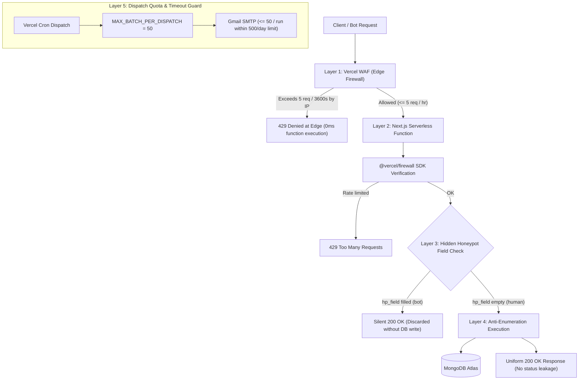

# Rate Limiting & Edge Defense Architecture

## Overview

The portfolio uses a defense-in-depth security model to protect public ingestion endpoints (`/api/send-email` and `/api/newsletter/subscribe`). It defends against volumetric denial-of-service, automated botnets, credential/subscriber enumeration, and Gmail daily sending quota exhaustion.

---

## Defense-in-Depth Model



---

## 1. Layer 1 & 2: Vercel Web Application Firewall (WAF) & Rate Limiting

Rate limiting is evaluated centrally at Vercel's global edge network rather than on individual serverless instances. This avoids cold-start resets, multi-region memory isolation, and node restarts.

### Live Configuration
- **Rule Name**: `Rate limit email endpoints`
- **Rule ID**: `rule_rate_limit_email_endpoints_l0RL18`
- **Matched Paths**: `/api/send-email`, `/api/newsletter/subscribe`
- **Method**: `POST`
- **Rate Limit**: `5 requests / 3600s (fixed_window)`
- **Key**: Client IP (`ip`)
- **Action**: `deny` (Returns `403 Forbidden` directly from Vercel Edge before function invocation)

### Client-Side Rate Limit Interception & Feedback
When Vercel Edge blocks a client with `403 Deny` (or API responds with `429`), frontend components (`NewsletterSubscribe.tsx` and `ContactForm.tsx`) intercept the HTTP status code before attempting JSON parsing:
- **Status Interception**: Detects `res.status === 403 || res.status === 429`.
- **Inline Badge**: Displays a polite inline warning (*"Rate limit reached (5 attempts per hour). Please try again later."*) directly within the component box.
- **Zero Full-Page Crashes**: Prevents non-JSON edge responses from triggering React uncaught rejections.

### Error Boundary Shield (`app/error.tsx` & `app/global-error.tsx`)
- **`app/error.tsx`**: Nested segment error boundary preserving the `RootLayout` (Navbar, Header, Footer, and Theme) on client component runtime errors, providing a branded "Try Again" recovery action.
- **`app/global-error.tsx`**: Root layout fallback replacing Next.js's raw generic crash screen with a styled, dark/light theme error container.

### Programmatic Route Handler Defense (`lib/rate-limit.ts`)
Using `@vercel/firewall`, route handlers verify the firewall rule programmatically:

```typescript
import { checkRateLimit as checkVercelRateLimit } from "@vercel/firewall";

export async function checkFirewallRateLimit(
  req: Request,
  ruleId: string = "rule_rate_limit_email_endpoints_l0RL18"
): Promise<{ success: boolean; error?: string }> {
  try {
    const { rateLimited } = await checkVercelRateLimit(ruleId, { request: req });
    if (rateLimited) {
      return { success: false, error: "Too many requests from this IP. Please try again later." };
    }
  } catch {
    // Graceful bypass in local development or non-Vercel runtimes
  }
  return { success: true };
}
```

In development mode (`next dev`), `@vercel/firewall` returns `{ success: true }` without blocking local testing.

---

## 2. Anti-Spoofing Client IP Resolution (`getClientIp`)

To prevent spoofing via forged `X-Forwarded-For` headers, client IP resolution uses a prioritized verification hierarchy:

```typescript
export function getClientIp(req: Request): string {
  // 1. Most trusted: x-real-ip is overwritten by the edge reverse proxy and cannot be forged by client
  const realIp = req.headers.get("x-real-ip");
  if (realIp && realIp.trim()) return realIp.trim();

  // 2. Vercel edge specific headers
  const vercelIp = req.headers.get("x-vercel-ip");
  if (vercelIp && vercelIp.trim()) return vercelIp.trim();

  // 3. Rightmost IP in X-Forwarded-For: Outermost trusted edge appends client IP to the end of chain
  const forwarded = req.headers.get("x-forwarded-for");
  if (forwarded) {
    const parts = forwarded.split(",").map((s) => s.trim()).filter(Boolean);
    if (parts.length > 0) return parts[parts.length - 1];
  }

  return "127.0.0.1";
}
```

---

## 3. Layer 3: Invisible Honeypot Botnet Protection

Automated scraping bots crawl DOM inputs and indiscriminately populate all fields before submitting.

### Frontend Trap (`components/NewsletterSubscribe.tsx`)
A hidden text field is placed outside the visual layout:

```tsx
<div style={{ display: "none" }} aria-hidden="true">
  <input
    type="text"
    name="hp_field"
    value={hpField}
    onChange={(e) => setHpField(e.target.value)}
    tabIndex={-1}
    autoComplete="off"
  />
</div>
```

### Backend Neutralization (`app/api/newsletter/subscribe/route.ts`)
When `hp_field` contains any value:
- The server drops the payload immediately.
- Zero database write operations occur.
- Returns `HTTP 200 OK` with the standard message. Bots receive a false positive success signal without discovering the defense.

---

## 4. Layer 4: Anti-Enumeration Shielding

Endpoints that disclose account existence (e.g. `already_subscribed`) allow attackers to enumerate email lists.

### Uniform Responses
Regardless of whether an address is:
1. Newly registered
2. Already active in the database
3. Re-activated from an unsubscribed state

The API returns the identical JSON response:
```json
{
  "success": true,
  "message": "Thank you for subscribing! Please check your inbox."
}
```

Internal status indicators (`subscribed` vs `already_subscribed`) are stripped from public responses.

---

## 5. Layer 5: Gmail Daily Quota & Execution Bounds

Gmail SMTP free tier enforces a strict **500 sends/day** limit across all portfolio notifications and newsletter broadcasts.

### Batch Protection Cap (`lib/newsletter.ts`)
To protect against runaway campaigns and Vercel 60s serverless timeouts:
- **`MAX_BATCH_PER_DISPATCH = 50`**: Each dispatch run processes at most 50 pending active recipients.
- **State Machine Resiliency**: If active subscribers exceed 50, the campaign status remains `partially_sent` (`hasMoreRemaining`), picking up where it left off in subsequent runs without duplicating sent emails (`$addToSet: { deliveredEmails: sub.email }`).
